# Fiber Projects
Various projects as I learn! (more TK)

# Alpaca: processing raw
Hoping to spin this; fleece obtained from a semi-local farmer.

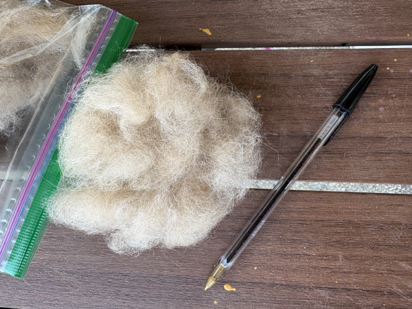

Here it's been washed and carded (cotton cards).

# Alpaca/Silk Blend: Dyeing and Spinning
An experiment dyeing some alpaca (processed from raw) and tussah silk that I'd carded together on cotton hand cards. [Dharma Trading Co.](https://www.dharmatrading.com) Procion MX (fiber-reactive) using the "vinegar" method. I think I'd rather try combing next, and acid dyes actually intended for use on protein fibers, but interesting results! Spun on an Ashford Traditional.

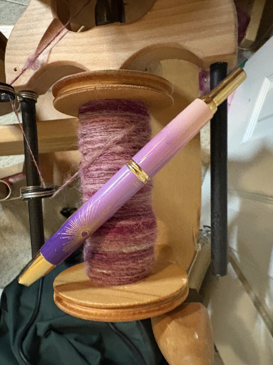

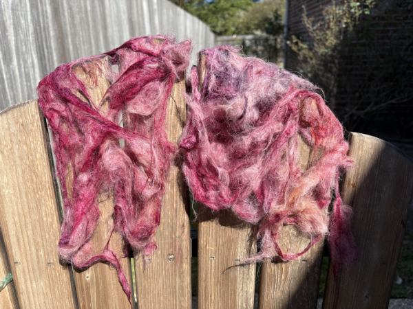

# Camel Cashmere Silk blend: Spinning
Camel Cashmere Silk blend from [IxCheL Fibre and Yarns](https://ixchel.com.au), spun on an Ashford Traditional.

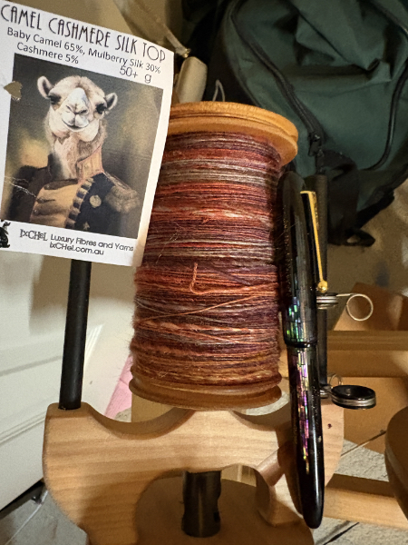

# Double Weave Placemats: Weaving
Rather cursed double weave in 3/2 cotton - cursed in that I hadn't resolved the shed on this particular counterbalance loom, the Inagaki R-25. The placemats were not intended to "match" pattern-wise.

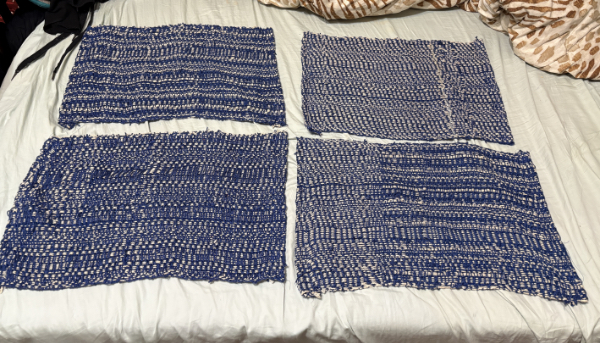

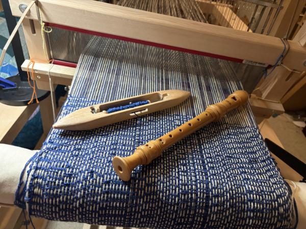

Catten "helped" tension my warp...

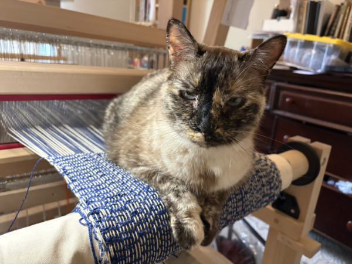

# Lakeview Placemats: Weaving
[Lakeview Placemats](https://www.gistyarn.com/products/lakeview-placemats-weaving-pattern) weaving pattern by Kristine Nichols (Gist Yarn), woven in 3/2 Beam cotton on a Saori WX60. I've got to try this in something closer to the sample colors!

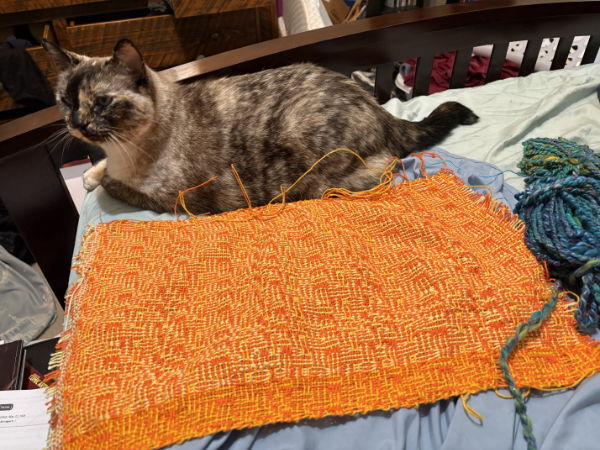

This is a somewhat cursed nachos colorway - woven for a friend to harmonize with living room colors. (We're both from Texas.) Catten for scale?

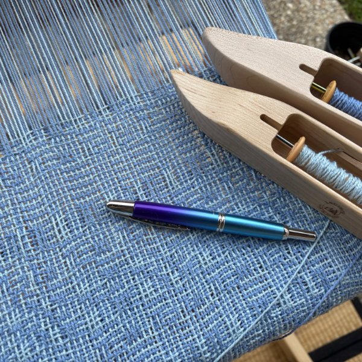

Earlier sample in a lower-contrast blues.

# Malabrigo Nube and Wool Blend: Spinning
People weren't kidding when they said Malabrigo Nube roving ("Whales' Road") was slightly annoying to work with. Here, it's plied with a wool blend art batt. Spun on a Spinolution Mach III with the 4A accelerated flyer.

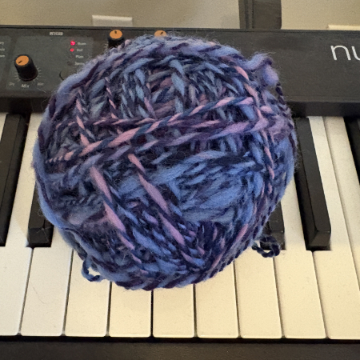

The yarn's very uneven, unfortunately: I was practicing spinning woolen, which I find wildly uncomfortable; I usually spin worsted or semi-worsted.

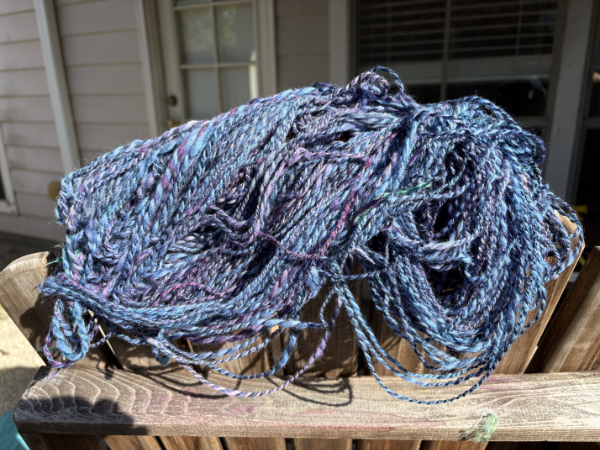

Here it's drying outside after being thwacked.

# Malabrigo Silky Alpaca: Dyeing
I couldn't obtain the amber colorway I wanted to I took some Malabrigo Silky Alpaca in Natural and dyed it myself.

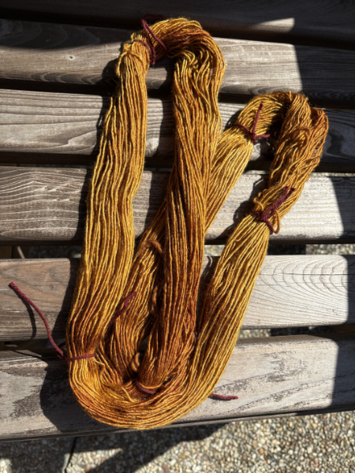

# Polwarth/Ramie/Tussah Silk blend: Spinning
Polwarth/ramie/tussah silk blend in "Never Let You Go" from [HipStrings](https://hipstrings.com). Spun on an Ashford Traditional.

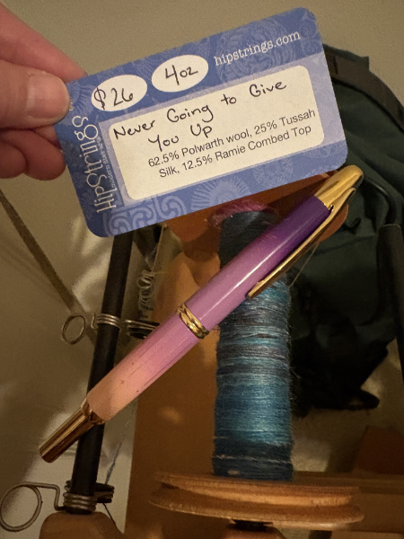

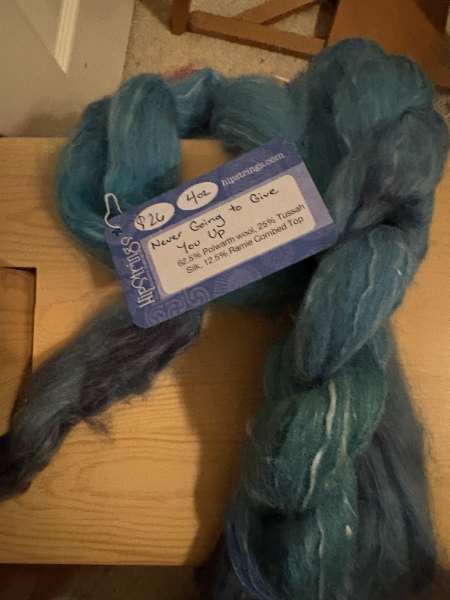

# Ramie-Silk Spinning: Cobweb
Spinning a 50-50 ramie/silk blend experimentally. Great for cobweb! Spun on a Spinolution Mach III with the 4A accelerated flyer.

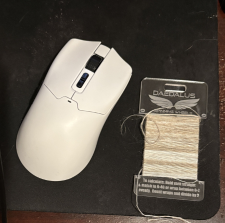

Computer mouse for scale.

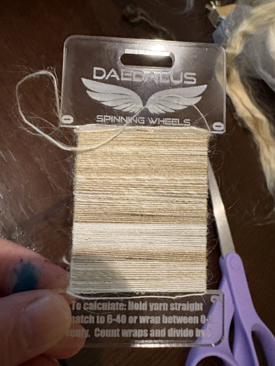

Close-up of wraps-per-inch assessment using the [Daedalus Spinning Wheels](https://www.daedalusspinningwheels.com) wraps-per-inch tool.

# Silk Dyeing
These are commercial silk yarns. They took the dye beautifully! [Dharma Trading Co.](https://www.dharmatrading.com) Procion MX (fiber-reactive dyes) using the "vinegar" method.

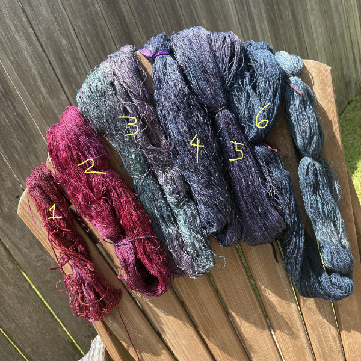

# Silk fiber dyeing
Procion MX dyes using the "vinegar" method. Now that I have some acid dyes, I'd like to try that too.

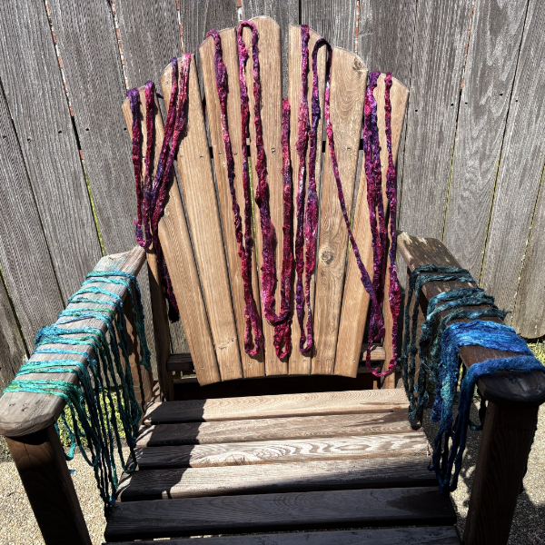

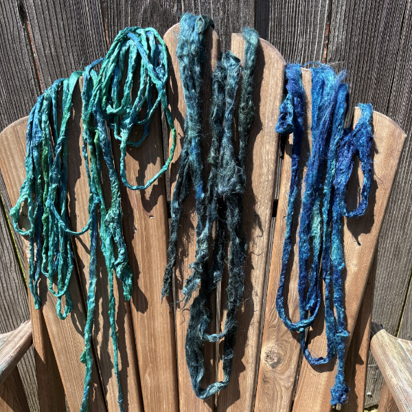

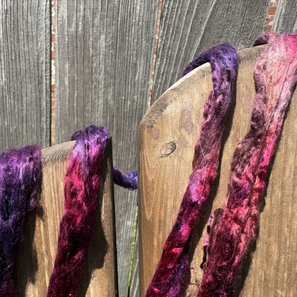

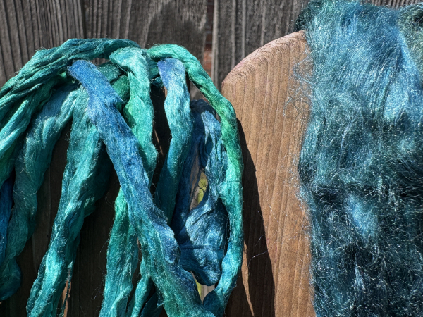

# Silk fiber dyeing and spinning: Cobweb

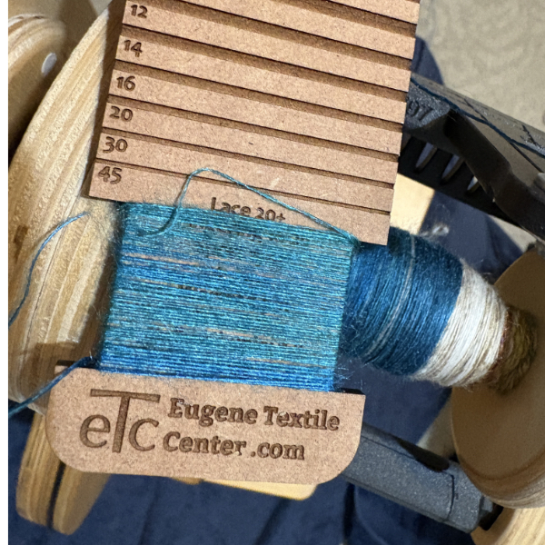

Spun on a Spinolution Mach III with the 4A accelerated flyer.

# Silk and Tencel Weaving WIP

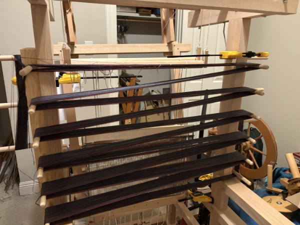

Measuring silk and tencel warp on a [Glimåkra Ronja](https://www.glimakrausa.com/ronja-warping-frame) warping frame C-clamped off-label to my [Inagaki R-25](https://inagakikiryo-weaving.com/products/handloom-r25) floor loom.

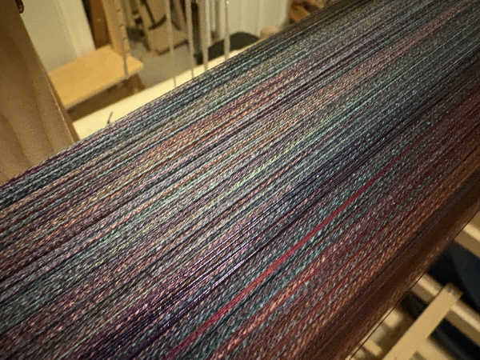

Close-up of a segment of the warp.

# Split Shed Weaving

Split shed weaving on a Saori WX60 during a Convergence 2026 workshop with weaver [Deborah Silver](https://www.deborahsilverstudio.com)! Her book *The Technique of Split Shed Weaving* goes into incredible detail on this technique.

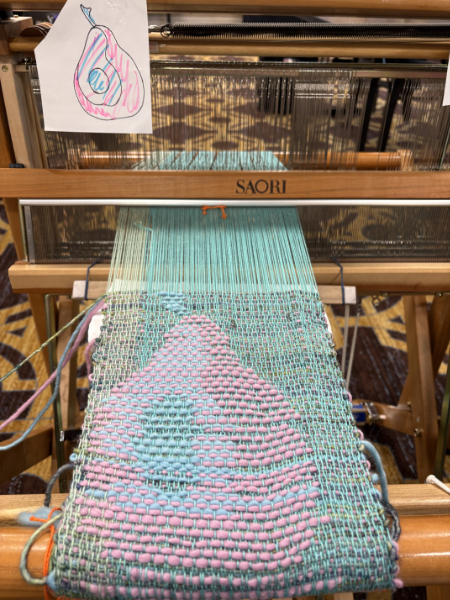

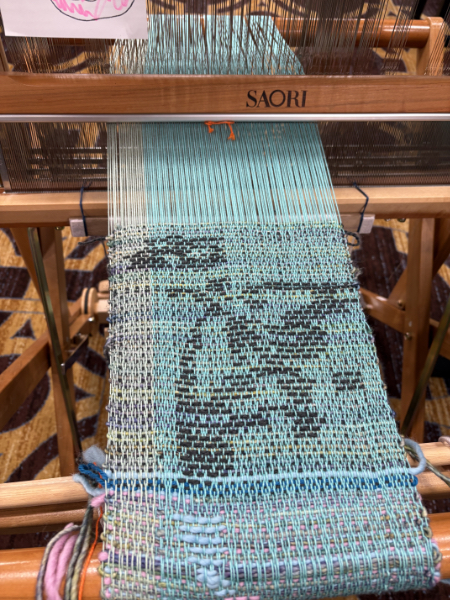

# Tencel Dyeing and Handspinning
Beautiful colors can be achieved using fiber-reactive dyes; I like spinning fine.

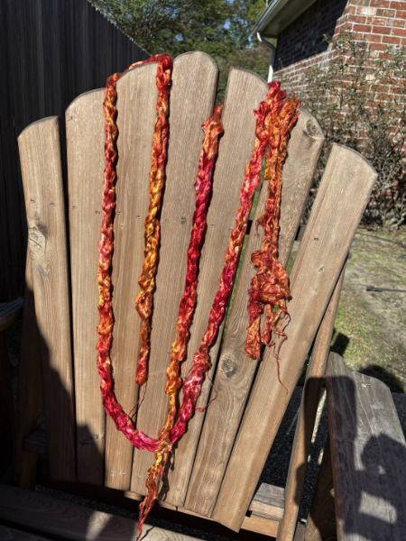

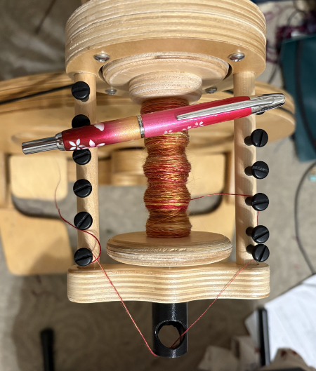

Spun on a Spinolution Mach III with the 4A accelerated flyer. Fountain pen for scale.

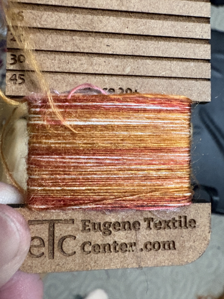

Assessing how fine I'm able to spin this with a wraps-per-inch tool from [Eugene Textile Center](https://www.eugenetextilecenter.com). (I think it was a freebie with one of my orders but I can't remember for sure.)

You can see how it looks as weft in this tencel plain weave project - it's the yellowy lighter stripe WIP.

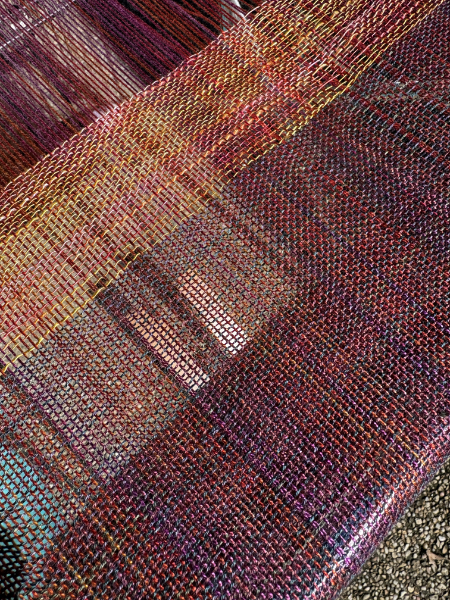

# Tencel Weaving
My first project on the [Toika Laila](https://www.toika.com/en/product/laila-loom/). Warp and weft by [Blazing Shuttles](https://www.blazingshuttles.com).

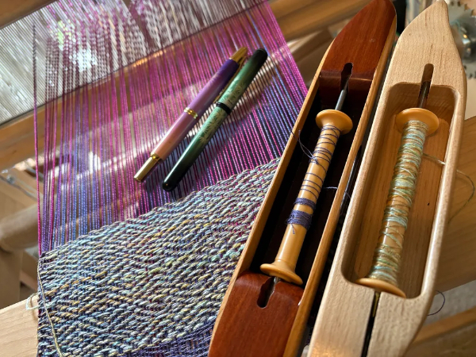

# Tencel Weaving
Experimenting with variegated tencels in "phoenix" colors. Catten for scale?! Mostly plain weave, modulo threading errors and other bloopers.

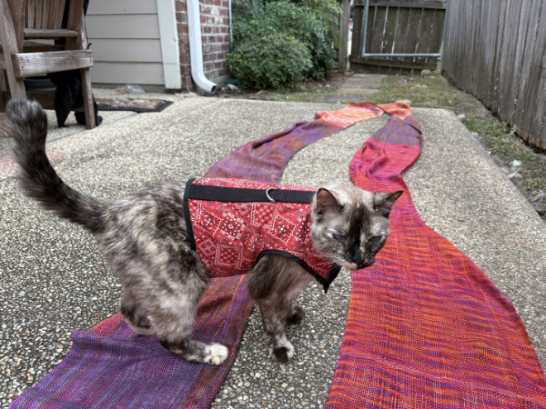

The middle section became this scarf, which is on its way to a friend as a gift!

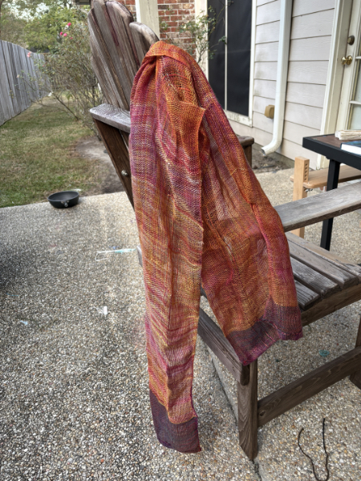

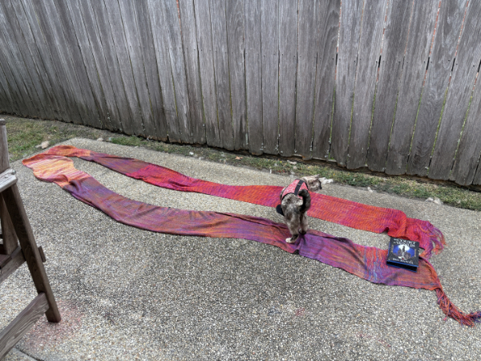

The yellowy weft stripe is my hand-dyed, handspun tencel! Woven on a Saori Piccolo.

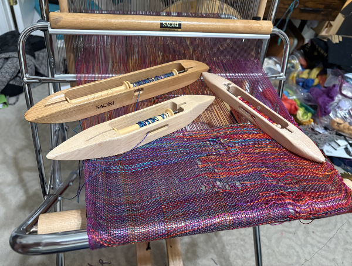

A brief experiment/sample section in clasped weft.

# Tiny Weaving
Tiny pocket-sized weaving on a DIY cardboard "pin loom" with my handspun.

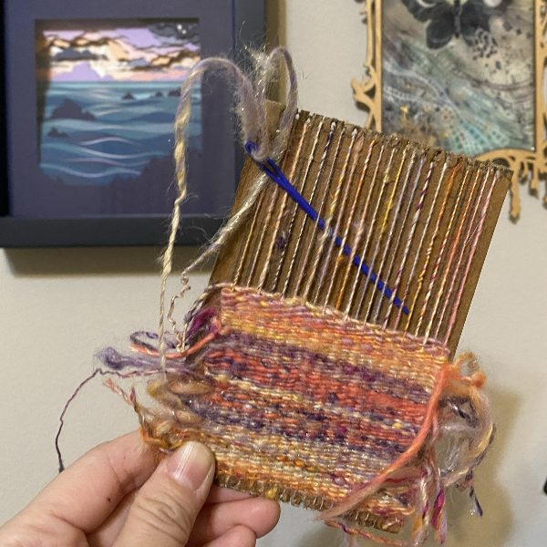

I ended up accidentally a double-width weave. Fun experience!

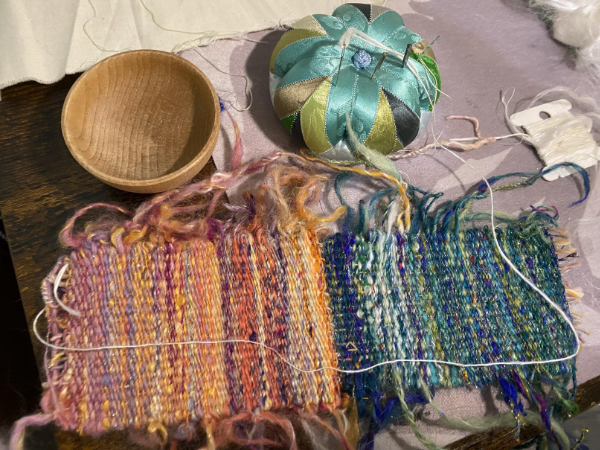

# Tussah silk: spinning (WIP)
Spinning cobweb on a Spinolution Mach III with the 4A accelerated flyer.

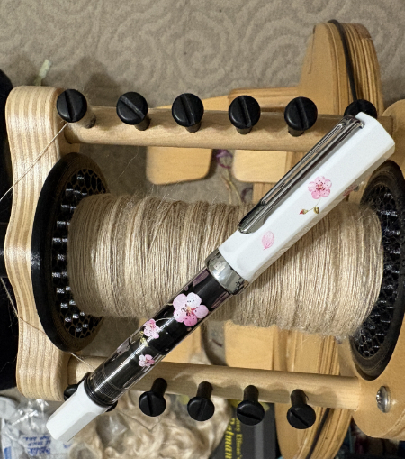

# Twill Gamp in cotton (WIP)
Draft from [School of SweetGeorgia](https://www.sweetgeorgia.co/)'s twill course! This is set up so a local friend can try weaving on a floor loom.

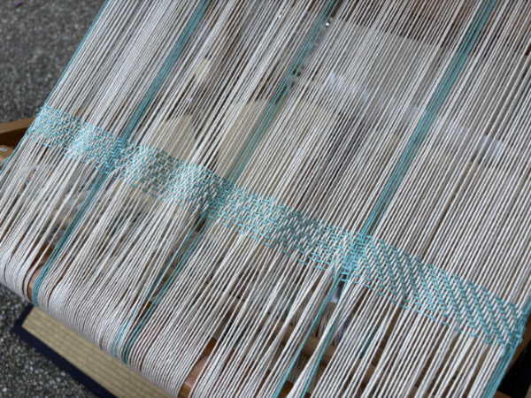

I need to fix the tension; this was a ~header as proof of concept.

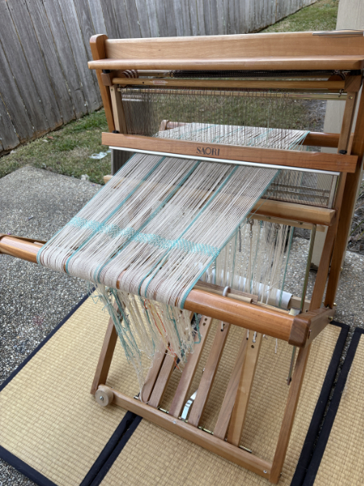

Set up on my Saori WX60.

# Wensleydale: fiber prep and spinning
Test spin of some "imperfect" Wensleydale I've been preparing from fleece. Clemes and Clemes cited "tenderness" and sold the fleece skirted and scoured. Spun on an Ashford Traditional.

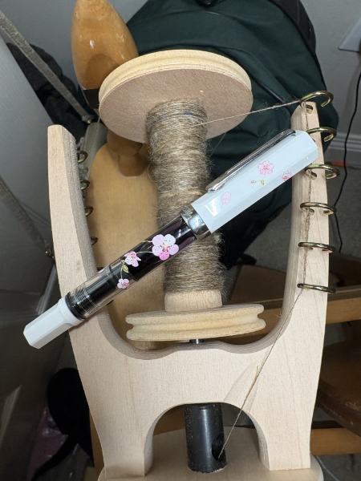

Look at that sheen! I don't spin a ton of wool by itself and not a lot of wool blends either, so this is educational.

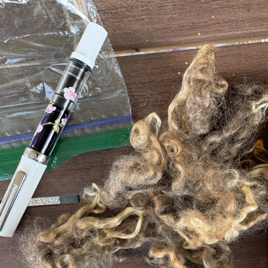

Some of the locks before I begin.

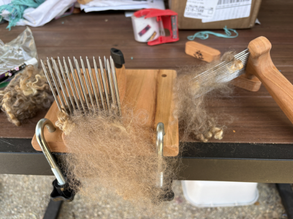

Beginning to comb this using extra-fine mini wool combs from [BAM Fiber Works](https://www.bamfiberworks.com).

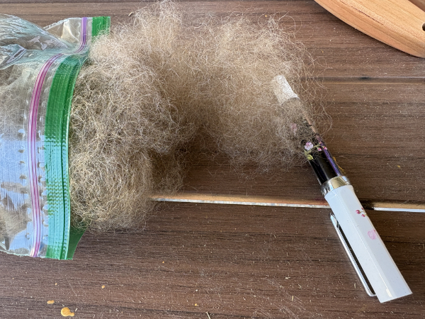
